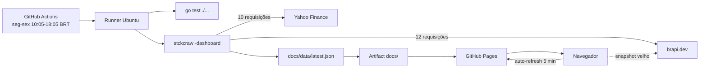

# stckcraw

[](https://github.com/fabianoflorentino/stckcraw/actions/workflows/dashboard.yml)
[](https://go.dev)
[](https://fabianoflorentino.github.io/stckcraw/)

Crawler em Go que gera um dashboard estático com as **10 maiores altas e baixas da B3 por tipo de ativo**. O site é atualizado a cada 30 minutos em dias úteis, das 10h às 18h (horário de Brasília), e publicado no GitHub Pages.

**Demo:** https://fabianoflorentino.github.io/stckcraw/  
**Workflow:** https://github.com/fabianoflorentino/stckcraw/actions/workflows/dashboard.yml

## O que tem

- **6 grupos:** Ações, FIIs, FIPs, ETFs, BDRs e Units.
- **Índices de mercado:** Ibovespa, Nasdaq, Euro Stoxx 50 e Shanghai, com valor, variação e horário da última cotação.
- **Cotações rápidas:** Dólar, Euro, Ouro, Brent, Bitcoin e S&P 500 em cards compactos no topo do hero, com variação colorida (alta, baixa ou estável).
- **Busca de ativos:** busca por ticker ou nome em toda a B3; o resultado abre o mesmo modal de gráfico, carregando o histórico sob demanda para ativos fora do top 10.
- **Carteira:** watchlist e posições com quantidade e preço médio, resultado em R$ e %, peso de cada ativo, export/import JSON e link compartilhável. Tudo fica no `localStorage`, sem conta ou servidor.
- **Gráficos diários:** cada índice em destaque e cada ativo das tabelas traz um mini gráfico; clique na linha (ou no mini gráfico) para abrir o histórico diário do último mês, com mínimo, máximo e variação do período.
- **Feriados da B3:** o snapshot marca `b3Closed` pelo horário do Ibovespa; quando a B3 não abre, o site mostra o último pregão e mantém os índices que operaram.
- **Altas e Baixas:** uma aba para cada direção, com top 10 por variação do dia.
- **Cards colapsáveis:** o cabeçalho inteiro do card recolhe/expande, com estado salvo no `localStorage`.
- **Voltar ao topo:** botão flutuante com scroll suave.
- **Atualização automática:** o site verifica o snapshot a cada 5 minutos; o workflow tenta gerar um novo a cada 30. Se o snapshot estiver velho ou ausente, o navegador consulta a brapi diretamente.
- **Docker:** sobe o dashboard local com atualização a cada 30 minutos.
- **Cloudflare:** cron dispatcher (`stckcraw-dispatch`) e espelho estático opcional (`stckcraw`).
- **Modo CSV legado:** ainda é possível baixar os CSVs do InfoMoney/XP com os filtros originais.
- **Sem dependências Go externas:** o binário usa apenas a biblioteca padrão.

## Como funciona



O crawler consulta a brapi **12 vezes por execução**: 6 tipos × 2 direções (`desc` para altas e `asc` para baixas). Também consulta a Yahoo Finance **10 vezes** para os índices e as cotações rápidas e em **lotes de até 20 símbolos** para o histórico dos ativos, usando `range=1mo&interval=1d`. O resultado é normalizado, os tickers fracionários são descartados e um único `latest.json` alimenta os cards de índices, as cotações compactas e as abas de altas/baixas.

A busca consulta `GET /quote/list?search=...` na brapi. Para ativos fora do snapshot, o histórico do gráfico é carregado sob demanda pelo endpoint `/history` do Worker Cloudflare, que usa Yahoo Spark e cache de borda. Localmente, rode `cd cloudflare && npx wrangler dev --port 8787` junto com o site.

O frontend usa o snapshot como cache: ele verifica a cada 5 minutos e, se o `latest.json` tiver mais de 35 minutos (ou o scheduler falhar), ele mesmo consulta a brapi e monta o mesmo contrato no navegador. Como a Yahoo não libera CORS, nesse fallback os índices e os mini gráficos dos ativos são mantidos do último snapshot — cada card mostra o horário da última cotação. O botão **Atualizar** força a consulta direta à brapi.

Quando o `asOf` do Ibovespa é de um dia anterior ao `generatedAt`, o status mostra **“B3 fechada · último pregão dd/mm/aaaa”**. Isso cobre fins de semana e feriados sem manter um calendário fixo; os índices de mercados que abriram continuam sendo atualizados.

Quando a Yahoo responde `429`, o crawler não sobrescreve os índices com erro: ele usa o último snapshot bom do próprio espelho Cloudflare (`indices-fallback-url`). Assim os cards continuam mostrando o último valor disponível, com o horário da cotação, em vez de "indisponível".

## Arquitetura

O documento completo, com diagramas de contexto, sequência, pacotes, deploy e tratamento de falhas, está em **[docs/architecture.md](docs/architecture.md)**.

Resumo dos pacotes:

| Pacote | Responsabilidade |
|---|---|
| `cmd/stckcraw` | entrada do binário e cancelamento por sinal |
| `internal/cli` | flags, exit codes, modos CSV/dashboard |
| `internal/brapi` | client HTTP do brapi.dev e catálogo de grupos |
| `internal/marketindex` | client Yahoo Finance dos índices e do histórico diário |
| `internal/dashboard` | monta o snapshot normalizado e grava o JSON |
| `internal/marketdata` | fonte InfoMoney/XP e variantes de filtro |
| `internal/crawler` | orquestração concorrente das variantes CSV |
| `internal/export` | geração dos CSVs no formato do site |

## Estrutura

```text
.
├── cmd/stckcraw/            # binário
├── internal/
│   ├── brapi/               # client brapi.dev
│   ├── marketindex/         # client Yahoo Finance dos índices
│   ├── cli/                 # CLI
│   ├── crawler/             # orquestrador CSV
│   ├── dashboard/           # snapshot JSON do dashboard
│   ├── export/              # writer CSV
│   └── marketdata/          # fonte InfoMoney/XP
├── docs/
│   ├── index.html           # dashboard
│   ├── style.css
│   ├── app.js
│   └── architecture.md      # documentação de arquitetura
├── cloudflare/              # cron dispatcher + site estático opcional
├── docker/entrypoint.sh     # loop de atualização local
├── .github/workflows/       # agendamento e deploy
├── Dockerfile
├── docker-compose.yml
├── Makefile
└── go.mod
```

## Rodando localmente

Requisitos: Go 1.27+.

```bash
# gera docs/data/latest.json e encerra (mesmo efeito de `make dashboard`)
make run

# gera docs/data/latest.json
make dashboard

# serve o dashboard em http://localhost:8000
make preview
```

Ou diretamente:

```bash
go run ./cmd/stckcraw -dashboard -out docs/data -limit 10
python3 -m http.server -d docs 8000

# opcional: cotações da carteira para ativos fora do snapshot
cd cloudflare && npx wrangler dev --port 8787
```

Opções úteis:

```bash
go run ./cmd/stckcraw -dashboard -out docs/data -limit 10
go run ./cmd/stckcraw -dashboard -brapi-base-url https://brapi.dev/api
go run ./cmd/stckcraw -list
```

### Modo CSV legado (InfoMoney/XP)

> A API legada do InfoMoney/XP pode responder `403 Acesso Bloqueado` conforme o IP/rede. Para gerar o dashboard, use o modo `-dashboard` (brapi + Yahoo), que é o caminho suportado.

```bash
# baixa todas as variantes para ./data
go run ./cmd/stckcraw -out data

# apenas ações da B3, formato do site
go run ./cmd/stckcraw -market b3 -type acao -format site -out data

# formato cru para análise
go run ./cmd/stckcraw -market b3 -index ibov -format raw -out data
```

## Docker

Requer Docker com o plugin **Compose v2** (`docker compose`). O compose sobe dois serviços:

- **dashboard**: executa o `stckcraw -dashboard` imediatamente e depois a cada 30 minutos.
- **web**: Nginx servindo o dashboard e o volume de dados em `http://localhost:8080`.

```bash
make docker-up
# ou
docker compose up --build
```

Acesse **http://localhost:8080**.

Comandos úteis:

```bash
make docker-logs          # logs do updater
make docker-down          # para os containers
make docker-reset         # para e remove o volume de dados
```

Variáveis de ambiente:

| Variável | Padrão | Descrição |
|---|---|---|
| `UPDATE_INTERVAL` | `1800` | intervalo em segundos entre atualizações |
| `WEB_PORT` | `8080` | porta local do Nginx |

Exemplo:

```bash
UPDATE_INTERVAL=900 WEB_PORT=8090 docker compose up --build
```

O updater roda imediatamente ao subir e alinha as próximas execuções aos múltiplos de 30 minutos. Se a brapi falhar, o snapshot anterior é preservado e a próxima tentativa ocorre no intervalo seguinte.

## Agendamento no GitHub Actions

O workflow `.github/workflows/dashboard.yml` roda:

- **dias úteis** (seg–sex)
- **10:05–18:05** no fuso `America/Sao_Paulo`
- a cada 30 minutos (minutos `:05` e `:35`, para fugir do topo da hora)
- em `push` para `main`/`master`
- manualmente via `workflow_dispatch`

O cron é “best effort”: o GitHub pode atrasar ou descartar execuções em horários de pico. Por isso o frontend tem o fallback direto na brapi quando o snapshot está velho. O botão **Workflow** continua levando à página do Actions para disparo manual.

Se quiser uma atualização automática do snapshot estático independente do scheduler do GitHub, existe o Worker opcional da Cloudflare em [cloudflare/README.md](cloudflare/README.md). Ele chama `workflow_dispatch` por cron e usa um PAT fine-grained guardado como secret.

O Cloudflare também tem um espelho estático opcional em `cloudflare/site`, publicado em https://stckcraw.fabianoflorentino.workers.dev. O workflow atualiza esse espelho quando o secret `CLOUDFLARE_API_TOKEN` está configurado; sem o secret, a etapa é ignorada.

## Contrato JSON

O arquivo `docs/data/latest.json` é o único contrato entre o crawler e o frontend:

```json
{
  "generatedAt": "2026-10-28T21:41:09Z",
  "source": "brapi.dev",
  "limit": 10,
  "b3AsOf": "2026-10-28T17:22:00Z",
  "b3Closed": false,
  "indices": [
    {
      "key": "ibovespa",
      "label": "Ibovespa",
      "symbol": "^BVSP",
      "price": 169081.88,
      "change": -1.12,
      "currency": "BRL",
      "timezone": "America/Sao_Paulo",
      "asOf": "2026-10-28T17:22:00Z",
      "history": [
        { "date": "2026-10-27T13:00:00Z", "close": 171006.1 },
        { "date": "2026-10-28T13:00:00Z", "close": 169081.88 }
      ]
    }
  ],
  "groups": [
    {
      "key": "acoes",
      "label": "Ações",
      "items": [
        {
          "rank": 1,
          "symbol": "MAPT3",
          "name": "CEMEPE INVESTIMENTOS S.A.",
          "price": 2.51,
          "change": 21.84,
          "financialVolume": 753,
          "marketCap": 2097277,
          "sector": "Miscellaneous",
          "history": [
            { "date": "2026-10-27T13:00:00Z", "close": 2.4 },
            { "date": "2026-10-28T13:00:00Z", "close": 2.51 }
          ]
        }
      ]
    }
  ],
  "lows": [
    {
      "key": "acoes",
      "label": "Ações",
      "items": []
    }
  ]
}
```

- `groups` contém as maiores altas.
- `lows` contém as maiores baixas.
- `error` aparece no grupo quando aquela consulta falha.
- `financialVolume` é aproximado por `preço × quantidade`, pois a brapi devolve quantidade.
- `b3AsOf`/`b3Closed` indicam o último pregão da B3 e se ele é anterior ao dia do snapshot.
- `indices[].history` e `groups[].items[].history` contêm os fechamentos diários do último mês, em ordem cronológica, usados no mini gráfico e na janela expandida.
- `indices[].compact` marca as cotações exibidas nos cards pequenos ao lado da busca; `indices[].unit` informa a unidade quando o preço não é monetário em BRL (por exemplo, `/oz` e `/bbl`).

## Carteira

A carteira fica só no navegador, em `localStorage` na chave `stckcraw:wallet`. Cada ativo tem `symbol`, `name`, `quantity` e `averagePrice`; quantidade vazia significa watchlist. O modo ativo também é lembrado em `stckcraw:mode`.

Cotações vêm do snapshot quando o ativo está no top 10; fora dele, o frontend consulta o Worker `/quote` (Yahoo), com fallback para a busca da brapi, cache de 5 minutos e último valor salvo no próprio `localStorage`.

Exportação:

```json
{
  "version": 1,
  "exported_at": "2026-11-19T22:00:00.000Z",
  "carteira": "Carteira",
  "assets": [
    { "symbol": "PETR4", "name": "Petrobras", "quantity": 100, "averagePrice": 30.5 }
  ]
}
```

O import faz união por ticker: ativos novos entram como watchlist ou posição; quantidades e preços médios existentes só são substituídos quando o arquivo traz valores maiores que zero. O link `?carteira=PETR4,VALE3` importa apenas os tickers, como watchlist, sem compartilhar quantidades.

## Dados e limitações

| Item | Situação |
|---|---|
| Fonte | brapi.dev (B3) + Yahoo Finance (índices e cotações), sem autenticação |
| Cobertura | B3: Ações, FIIs, FIPs, ETFs, BDRs e Units |
| Índices | Ibovespa (`^BVSP`), Nasdaq (`^IXIC`), Euro Stoxx 50 (`^STOXX50E`) e Shanghai (`000001.SS`) |
| Cotações rápidas | Dólar (`BRL=X`), Euro (`EURBRL=X`), Ouro (`GC=F`), Brent (`BZ=F`), Bitcoin (`BTC-USD`) e S&P 500 (`^GSPC`) |
| Horário dos índices | cada card mostra a última cotação no fuso da bolsa |
| Gráficos | fechamentos diários de 1 mês para índices e ativos, em SVG nativo e sem biblioteca externa |
| Histórico dos ativos | Yahoo Spark em lotes de até 20 símbolos `.SA`; ativos sem série ficam sem gráfico |
| Preço vs. gráfico | preço/variação da tabela vêm da brapi; os fechamentos do gráfico vêm da Yahoo, então pequenas diferenças são esperadas |
| Ordenação | variação percentual do dia |
| Volume | aproximado (`preço × quantidade`) |
| Nasdaq/NYSE no CSV legado | não implementados |
| Tickers fracionários | descartados |
| Feriados B3 | o workflow roda, marca `b3Closed` e mantém o último pregão da B3; os índices abertos seguem atualizando |
| Rate limit brapi | 20 req/min; usamos 12 por execução |
| Fallback do navegador | consulta a brapi quando o snapshot tem mais de 35 min |
| Fallback de índices | a Yahoo não expõe CORS; o navegador mantém os índices do último snapshot |
| Busca | brapi `/quote/list?search=...`, sem token; histórico do ativo via Worker `/history` |
| Yahoo `429` | o crawler usa o último snapshot bom do espelho Cloudflare, em vez de gravar `error` |

## Qualidade

```bash
go test -race ./...
golangci-lint run ./...
node --check docs/app.js
```

O workflow executa `go test ./...` antes de publicar. O lint local usa o `.golangci.yml` do repositório.

## Aviso

Dados informativos; não é recomendação de investimento.
