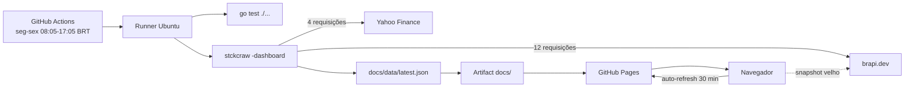

# stckcraw

[](https://github.com/fabianoflorentino/stckcraw/actions/workflows/dashboard.yml)
[](https://go.dev)
[](https://fabianoflorentino.github.io/stckcraw/)

Crawler em Go que gera um dashboard estático com as **10 maiores altas e baixas da B3 por tipo de ativo**. O site é atualizado a cada 30 minutos em dias úteis e publicado no GitHub Pages.

**Demo:** https://fabianoflorentino.github.io/stckcraw/  
**Workflow:** https://github.com/fabianoflorentino/stckcraw/actions/workflows/dashboard.yml

## O que tem

- **6 grupos:** Ações, FIIs, FIPs, ETFs, BDRs e Units.
- **Índices de mercado:** Ibovespa, S&P 500, Euro Stoxx 50 e Shanghai, com valor, variação e horário da última cotação.
- **Altas e Baixas:** uma aba para cada direção, com top 10 por variação do dia.
- **Cards colapsáveis:** o cabeçalho inteiro do card recolhe/expande, com estado salvo no `localStorage`.
- **Voltar ao topo:** botão flutuante com scroll suave.
- **Atualização automática:** o site verifica o snapshot a cada 30 minutos; se ele estiver velho ou ausente, consulta a brapi diretamente no navegador.
- **Docker:** sobe o dashboard local com atualização a cada 30 minutos.
- **Cloudflare Worker opcional:** cron independente que dispara o workflow no GitHub.
- **Modo CSV legado:** ainda é possível baixar os CSVs do InfoMoney/XP com os filtros originais.
- **Sem dependências Go externas:** o binário usa apenas a biblioteca padrão.

## Como funciona



O crawler consulta a brapi **12 vezes por execução**: 6 tipos × 2 direções (`desc` para altas e `asc` para baixas). Também consulta a Yahoo Finance **4 vezes** para os índices. O resultado é normalizado, os tickers fracionários são descartados e um único `latest.json` alimenta os cards de índices e as abas de altas/baixas.

O frontend usa o snapshot como cache: se o `latest.json` tiver mais de 35 minutos (ou o scheduler falhar), ele mesmo consulta a brapi e monta o mesmo contrato no navegador. Como a Yahoo não libera CORS, nesse fallback os índices são mantidos do último snapshot — cada card mostra o horário da última cotação. O botão **Atualizar** força a consulta direta à brapi.

## Arquitetura

O documento completo, com diagramas de contexto, sequência, pacotes, deploy e tratamento de falhas, está em **[docs/architecture.md](docs/architecture.md)**.

Resumo dos pacotes:

| Pacote | Responsabilidade |
|---|---|
| `cmd/stckcraw` | entrada do binário e cancelamento por sinal |
| `internal/cli` | flags, exit codes, modos CSV/dashboard |
| `internal/brapi` | client HTTP do brapi.dev e catálogo de grupos |
| `internal/marketindex` | client Yahoo Finance dos índices de mercado |
| `internal/dashboard` | monta o snapshot normalizado e grava o JSON |
| `internal/marketdata` | fonte InfoMoney/XP e variantes de filtro |
| `internal/crawler` | orquestração concorrente das variantes CSV |
| `internal/export` | geração dos CSVs no formato do site |

## Estrutura

```text
.
├── cmd/stckcraw/            # binário
├── internal/
│   ├── brapi/               # client brapi.dev
│   ├── marketindex/         # client Yahoo Finance dos índices
│   ├── cli/                 # CLI
│   ├── crawler/             # orquestrador CSV
│   ├── dashboard/           # snapshot JSON do dashboard
│   ├── export/              # writer CSV
│   └── marketdata/          # fonte InfoMoney/XP
├── docs/
│   ├── index.html           # dashboard
│   ├── style.css
│   ├── app.js
│   └── architecture.md      # documentação de arquitetura
├── cloudflare/              # Worker opcional de gatilho
├── docker/entrypoint.sh     # loop de atualização local
├── .github/workflows/       # agendamento e deploy
├── Dockerfile
├── docker-compose.yml
├── Makefile
└── go.mod
```

## Rodando localmente

Requisitos: Go 1.27+.

```bash
# gera docs/data/latest.json
make dashboard

# serve o dashboard em http://localhost:8000
make preview
```

Ou diretamente:

```bash
go run ./cmd/stckcraw -dashboard -out docs/data -limit 10
python3 -m http.server -d docs 8000
```

Opções úteis:

```bash
go run ./cmd/stckcraw -dashboard -out docs/data -limit 10
go run ./cmd/stckcraw -dashboard -brapi-base-url https://brapi.dev/api
go run ./cmd/stckcraw -list
```

### Modo CSV legado (InfoMoney/XP)

```bash
# baixa todas as variantes para ./data
go run ./cmd/stckcraw -out data

# apenas ações da B3, formato do site
go run ./cmd/stckcraw -market b3 -type acao -format site -out data

# formato cru para análise
go run ./cmd/stckcraw -market b3 -index ibov -format raw -out data
```

## Docker

Requer Docker com o plugin **Compose v2** (`docker compose`). O compose sobe dois serviços:

- **dashboard**: executa o `stckcraw -dashboard` imediatamente e depois a cada 30 minutos.
- **web**: Nginx servindo o dashboard e o volume de dados em `http://localhost:8080`.

```bash
make docker-up
# ou
docker compose up --build
```

Acesse **http://localhost:8080**.

Comandos úteis:

```bash
make docker-logs          # logs do updater
make docker-down          # para os containers
make docker-reset         # para e remove o volume de dados
```

Variáveis de ambiente:

| Variável | Padrão | Descrição |
|---|---|---|
| `UPDATE_INTERVAL` | `1800` | intervalo em segundos entre atualizações |
| `WEB_PORT` | `8080` | porta local do Nginx |

Exemplo:

```bash
UPDATE_INTERVAL=900 WEB_PORT=8090 docker compose up --build
```

O updater roda imediatamente ao subir e alinha as próximas execuções aos múltiplos de 30 minutos. Se a brapi falhar, o snapshot anterior é preservado e a próxima tentativa ocorre no intervalo seguinte.

## Agendamento no GitHub Actions

O workflow `.github/workflows/dashboard.yml` roda:

- **dias úteis** (seg–sex)
- **08:05–17:05** no fuso `America/Sao_Paulo`
- a cada 30 minutos (minutos `:05` e `:35`, para fugir do topo da hora)
- em `push` para `main`/`master`
- manualmente via `workflow_dispatch`

O cron é “best effort”: o GitHub pode atrasar ou descartar execuções em horários de pico. Por isso o frontend tem o fallback direto na brapi quando o snapshot está velho. O botão **Workflow** continua levando à página do Actions para disparo manual.

Se quiser uma atualização automática do snapshot estático independente do scheduler do GitHub, existe o Worker opcional da Cloudflare em [cloudflare/README.md](cloudflare/README.md). Ele chama `workflow_dispatch` por cron e usa um PAT fine-grained guardado como secret.

## Contrato JSON

O arquivo `docs/data/latest.json` é o único contrato entre o crawler e o frontend:

```json
{
  "generatedAt": "2026-10-28T21:41:09Z",
  "source": "brapi.dev",
  "limit": 10,
  "indices": [
    {
      "key": "ibovespa",
      "label": "Ibovespa",
      "symbol": "^BVSP",
      "price": 169081.88,
      "change": -1.12,
      "currency": "BRL",
      "timezone": "America/Sao_Paulo",
      "asOf": "2026-10-29T17:22:00Z"
    }
  ],
  "groups": [
    {
      "key": "acoes",
      "label": "Ações",
      "items": [
        {
          "rank": 1,
          "symbol": "MAPT3",
          "name": "CEMEPE INVESTIMENTOS S.A.",
          "price": 2.51,
          "change": 21.84,
          "financialVolume": 753,
          "marketCap": 2097277,
          "sector": "Miscellaneous"
        }
      ]
    }
  ],
  "lows": [
    {
      "key": "acoes",
      "label": "Ações",
      "items": []
    }
  ]
}
```

- `groups` contém as maiores altas.
- `lows` contém as maiores baixas.
- `error` aparece no grupo quando aquela consulta falha.
- `financialVolume` é aproximado por `preço × quantidade`, pois a brapi devolve quantidade.

## Dados e limitações

| Item | Situação |
|---|---|
| Fonte | brapi.dev (B3) + Yahoo Finance (índices), sem autenticação |
| Cobertura | B3: Ações, FIIs, FIPs, ETFs, BDRs e Units |
| Índices | Ibovespa (`^BVSP`), S&P 500 (`^GSPC`), Euro Stoxx 50 (`^STOXX50E`) e Shanghai (`000001.SS`) |
| Horário dos índices | cada card mostra a última cotação no fuso da bolsa |
| Ordenação | variação percentual do dia |
| Volume | aproximado (`preço × quantidade`) |
| Nasdaq/NYSE | não implementados |
| Tickers fracionários | descartados |
| Feriados B3 | o workflow roda mesmo assim e repete o último snapshot |
| Rate limit brapi | 20 req/min; usamos 12 por execução |
| Fallback do navegador | consulta a brapi quando o snapshot tem mais de 35 min |
| Fallback de índices | a Yahoo não expõe CORS; o navegador mantém os índices do último snapshot |

## Qualidade

```bash
go test -race ./...
golangci-lint run ./...
node --check docs/app.js
```

O workflow executa `go test ./...` antes de publicar. O lint local usa o `.golangci.yml` do repositório.

## Aviso

Dados informativos; não é recomendação de investimento.
