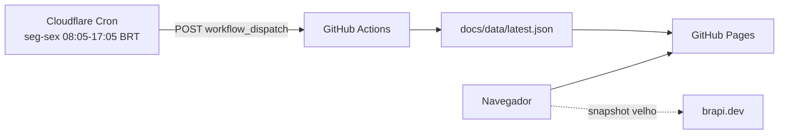

# Cloudflare Worker: gatilho do dashboard

Worker opcional que dispara o workflow `dashboard.yml` usando um cron da Cloudflare, independente do scheduler do GitHub.



O Worker **não gera dados**: ele apenas chama a API do GitHub para iniciar o workflow. O workflow continua sendo o responsável por consultar a brapi e publicar o Pages.

> **Importante:** o site continua no GitHub Pages. Este Worker é só um script de cron/dispatch, chamado `stckcraw-dispatch`. Não suba a pasta `docs/` como Workers Static Assets nem use `wrangler pages deploy` para ele; Workers que só têm assets estáticos (como o `stckcraw` do site) não aceitam Cron Triggers.

**Worker deployado:** https://stckcraw-dispatch.fabianoflorentino.workers.dev

## Por que existe

O `schedule` do GitHub é “best effort” e, neste projeto, não disparou nenhum run por horas. A Cloudflare Cron é um scheduler independente: ela chama o GitHub, e o workflow roda pelo gatilho `workflow_dispatch` (que já funciona).

## Pré-requisitos

- Conta na Cloudflare.
- Node.js e `npx` (para o Wrangler).
- Um **fine-grained PAT** do GitHub com permissão de `Actions: write`.

## 1. Criar o PAT

Em GitHub → Settings → Developer settings → Personal access tokens → Fine-grained tokens:

- **Repository access:** Only select repositories → `stckcraw`
- **Permissions:**
  - Actions: **Read and write**
  - Metadata: **Read** (obrigatório)
- **Expiration:** 90 dias ou 1 ano (anote para renovar)

Não use um token clássico com `repo` inteiro; o fine-grained reduz o escopo.

## 2. Instalar/autenticar o Wrangler

```bash
cd cloudflare
npm install
npx wrangler login
```

## 3. Configurar os secrets

```bash
npx wrangler secret put GITHUB_TOKEN
# cole o PAT quando pedir

# opcional: protege o endpoint /trigger para testes manuais
npx wrangler secret put TRIGGER_SECRET
```

`GITHUB_TOKEN` e `TRIGGER_SECRET` nunca ficam no repositório. O `wrangler.toml` contém apenas variáveis públicas (`GITHUB_OWNER`, `GITHUB_REPO`, etc.).

> Sem `GITHUB_TOKEN`, o cron dispara mas falha com `missing GITHUB_OWNER, GITHUB_REPO, GITHUB_WORKFLOW or GITHUB_TOKEN`. Confira com `npx wrangler secret list`.

## 4. Deploy

```bash
npx wrangler deploy
npx wrangler tail
```

O cron configurado no `wrangler.toml` roda:

- `5,35 11-19 UTC` → 08:05–16:35 BRT
- `5 20 UTC` → 17:05 BRT
- somente segunda a sexta (`1-5`)

## 5. Testar

Com `TRIGGER_SECRET` configurado, dispare manualmente:

```bash
curl -X POST "https://stckcraw-dispatch.<seu-subdominio>.workers.dev/trigger" \
  -H "Authorization: Bearer $TRIGGER_SECRET"
```

Resposta esperada: `{"ok":true}` e um novo run `workflow_dispatch` no GitHub Actions.

Também é possível testar sem deploy:

```bash
npx wrangler dev --test-scheduled
curl "http://localhost:8787/__scheduled?cron=5,35+11-19+*+*+1-5"
```

`/health` responde `ok` e serve para verificar se o Worker está no ar.

## Segurança

- O PAT deve ter o menor escopo possível: apenas este repositório e `Actions: write`.
- Defina expiração e renove antes de vencer.
- Não coloque o PAT no `docs/app.js`, no repositório ou em variáveis públicas do `wrangler.toml`.
- O endpoint `/trigger` exige `TRIGGER_SECRET`; sem o secret, ele responde `401`.
- O botão **Atualizar** do site **não** chama esse endpoint: ele busca a brapi diretamente no navegador. O Worker existe para manter o snapshot estático atualizado.
- O endpoint público expõe apenas `/health` e `/trigger`; qualquer outra rota responde `404`.

## Custo

O plano free da Cloudflare é suficiente: cerca de 19 execuções por dia útil, sem armazenamento e sem banco de dados.

## Troubleshooting

| Sintoma | Verifique |
|---|---|
| `401` no `/trigger` | `TRIGGER_SECRET` configurado e header `Authorization: Bearer ...` correto |
| `GitHub dispatch failed: 401/403` | PAT expirado, sem `Actions: write` ou sem acesso ao repo |
| `GitHub dispatch failed: 404` | `GITHUB_OWNER`, `GITHUB_REPO`, `GITHUB_WORKFLOW` ou `GITHUB_REF` errados |
| Cron não roda | `wrangler tail`, status do Worker no dashboard e os horários em UTC |
| Workflow não publica | veja o run no Actions; o Worker só dispara o workflow |
| `Triggers cannot be added to a Worker that only has static assets` | o Worker foi criado/deployado como static assets ou Pages. O cron precisa ser um script Worker: `main = "src/index.js"` no `wrangler.toml`, sem `[assets]`. Rode `npx wrangler deploy` dentro de `cloudflare/`; o Worker de cron é `stckcraw-dispatch`, não o `stckcraw` de assets. Se o nome já existir como assets-only, apague esse Worker ou troque o `name` no `wrangler.toml` |

Se o Worker falhar, o site continua funcionando pelo fallback no navegador.
