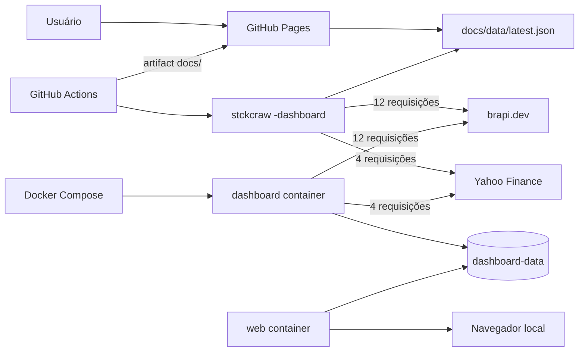
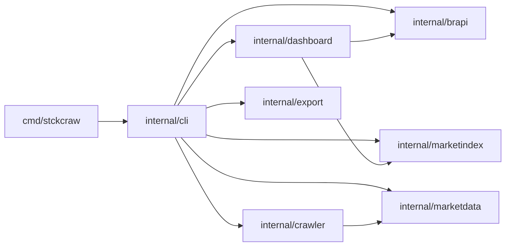
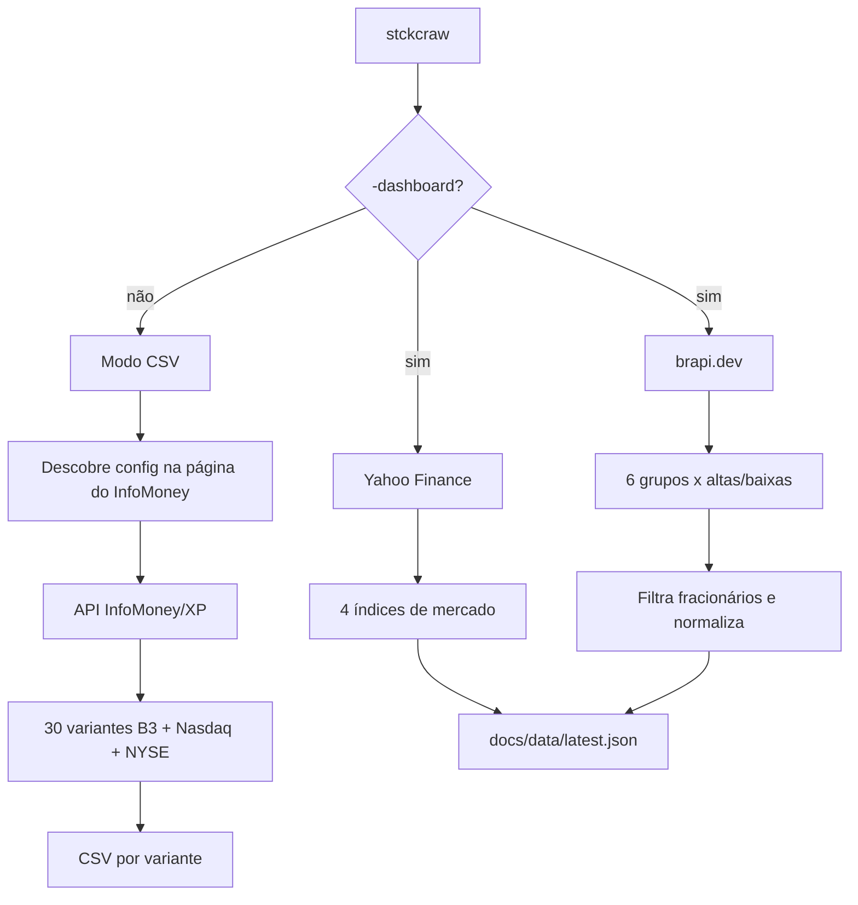
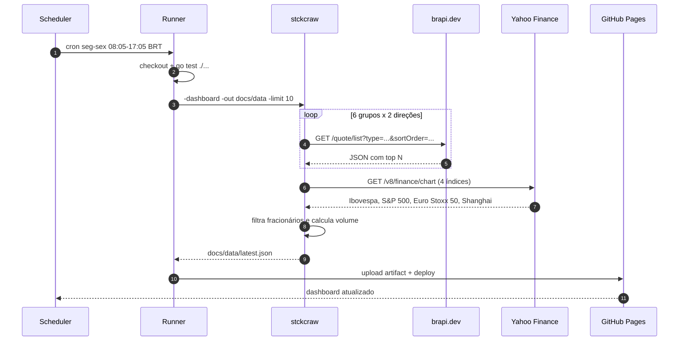
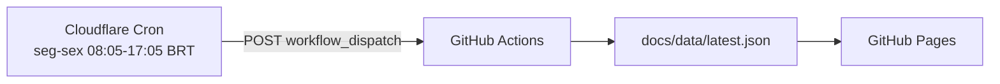
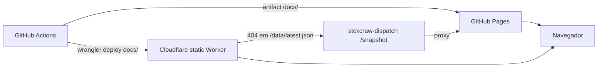
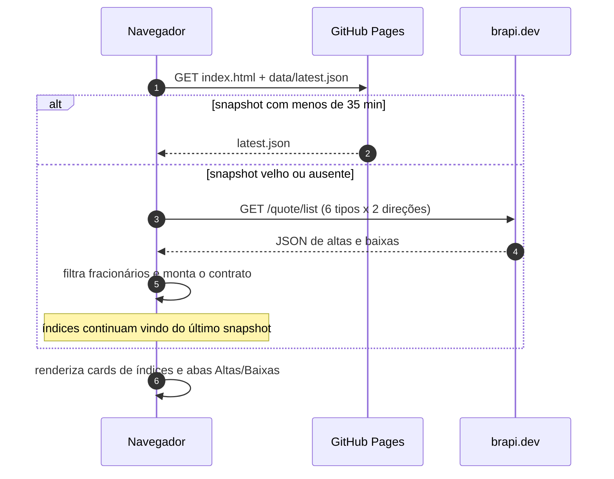
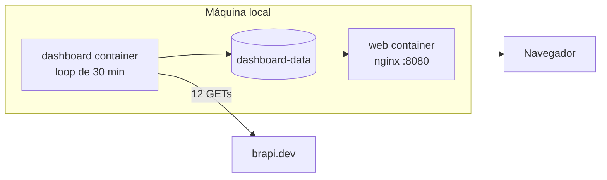
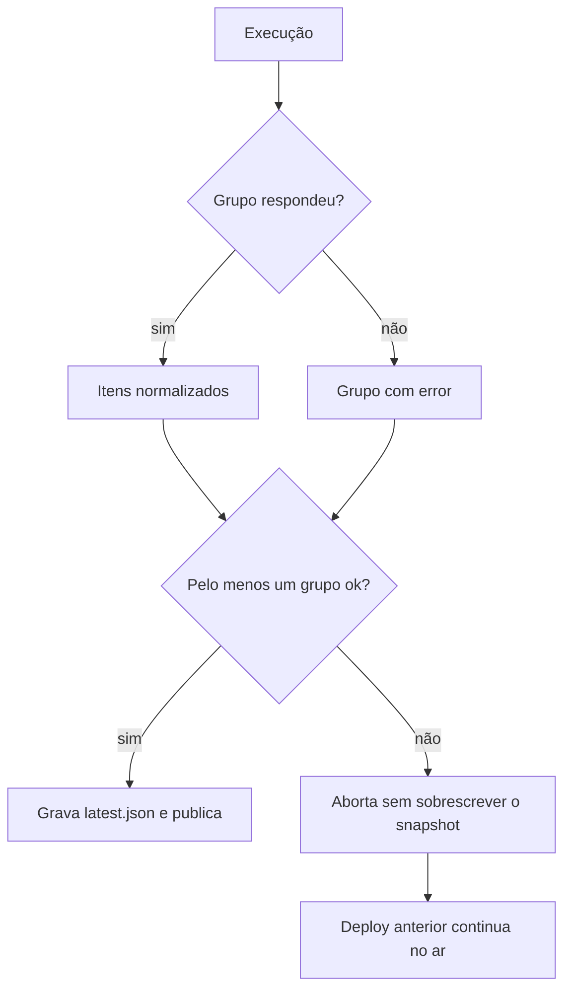

# Arquitetura do stckcraw

Documento técnico do crawler e do dashboard. Para o guia rápido de uso, veja o [README](../README.md).

## 1. Visão geral

O projeto tem dois modos no mesmo binário:

1. **Dashboard** (`-dashboard`): consulta a brapi.dev e gera um JSON normalizado consumido pelo GitHub Pages.
2. **CSV legado**: baixa os leaderboards do InfoMoney/XP por variante de filtro e grava um CSV por arquivo.

No navegador, o frontend usa o `latest.json` como cache. Se o snapshot estiver ausente ou tiver mais de 35 minutos, ele consulta a brapi diretamente e monta o mesmo contrato. Isso mantém o site atualizado mesmo quando o scheduler do GitHub falha.

O modo dashboard é o usado no deploy automático. O modo CSV continua disponível para exploração e comparação.

## 2. Contexto



## 3. Componentes

| Pacote | Tipo | Responsabilidade |
|---|---|---|
| `cmd/stckcraw` | entrypoint | cria o contexto com `signal.NotifyContext` e chama a CLI |
| `internal/cli` | interface | flags, validação, exit codes e seleção de modo |
| `internal/brapi` | adapter | client do `/quote/list`, grupos e `sortOrder` |
| `internal/marketindex` | adapter | client Yahoo Finance dos índices |
| `internal/dashboard` | use case | consulta altas/baixas, normaliza itens e grava o snapshot |
| `internal/marketdata` | adapter legado | descoberta da config, client XP e variantes de filtro |
| `internal/crawler` | use case legado | orquestra as variantes CSV com concorrência limitada |
| `internal/export` | adapter | formatação e escrita dos CSVs |

## 4. Dependências entre pacotes



As dependências apontam para dentro: CLI conhece os casos de uso, os casos de uso conhecem interfaces/adapters, e o domínio (`Quote`, `Item`, `Group`) não importa HTTP.

## 5. Fluxo do CLI



## 6. Fluxo agendado



O workflow também dispara em `push` para `main`/`master` e em `workflow_dispatch` manual. O cron usa `timezone: America/Sao_Paulo` e minutos `:05`/`:35` para reduzir a chance de o GitHub descartar a execução no topo da hora.

### Agendamento alternativo com Cloudflare

Se o scheduler do GitHub não disparar, o Worker opcional `cloudflare/` assume o papel de cron e chama `workflow_dispatch` pela API do GitHub:



O PAT fica como secret do Worker; não entra no repositório nem no `docs/app.js`. O Worker não gera dados: apenas inicia o workflow, que continua consultando a brapi e publicando o Pages.

### Espelho estático no Cloudflare

O `cloudflare/site/wrangler.toml` publica `docs/` no Worker `stckcraw` (assets-only). O cron continua separado no `stckcraw-dispatch`.



O workflow só faz o deploy do espelho quando o secret `CLOUDFLARE_API_TOKEN` existe; sem ele, a etapa é ignorada e o Pages continua sendo a fonte principal. O `/snapshot` do dispatcher é o fallback do espelho quando o JSON gerado não está nos assets (caso típico de um build Git do Cloudflare sem `docs/data/latest.json`).

## 7. Fallback no navegador



O fallback depende de CORS. A brapi responde `access-control-allow-origin: *`, então o navegador pode chamar o endpoint diretamente.

## 8. Deploy local com Docker



- O container `dashboard` roda o binário imediatamente e depois alinha as execuções aos múltiplos de `UPDATE_INTERVAL` (padrão 1800 s).
- O container `web` monta `docs/` e o volume `dashboard-data` em `/usr/share/nginx/html/data`.
- Se uma atualização falhar, o snapshot anterior permanece no volume.

## 9. Contrato JSON

O frontend prefere este contrato, venha ele do snapshot gerado pelo Go ou do fallback no navegador:

```json
{
  "generatedAt": "2026-10-28T21:41:09Z",
  "source": "brapi.dev",
  "limit": 10,
  "indices": [
    {
      "key": "ibovespa",
      "label": "Ibovespa",
      "symbol": "^BVSP",
      "price": 169081.88,
      "change": -1.12,
      "currency": "BRL",
      "timezone": "America/Sao_Paulo",
      "asOf": "2026-10-29T17:22:00Z"
    }
  ],
  "groups": [
    {
      "key": "acoes",
      "label": "Ações",
      "items": [
        {
          "rank": 1,
          "symbol": "MAPT3",
          "name": "CEMEPE INVESTIMENTOS S.A.",
          "price": 2.51,
          "change": 21.84,
          "financialVolume": 753,
          "marketCap": 2097277,
          "sector": "Miscellaneous"
        }
      ]
    }
  ],
  "lows": []
}
```

| Campo | Origem | Observação |
|---|---|---|
| `symbol` | `stock` | ticker B3 |
| `name` | `name` | nome do ativo |
| `price` | `close` | último preço |
| `change` | `change` | variação percentual do dia |
| `financialVolume` | `close * volume` | aproximado, pois `volume` é quantidade |
| `marketCap` | `market_cap` | pode ser nulo |
| `sector` | `sector` | pode ser nulo |
| `rank` | calculado | 1..limit após filtro de fracionários |
| `error` | calculado | presente apenas quando o grupo falha |
| `indices[].price` | `regularMarketPrice` | último valor do índice |
| `indices[].change` | `price / chartPreviousClose` | variação percentual |
| `indices[].asOf` | `regularMarketTime` | horário UTC da última cotação |
| `indices[].timezone` | `exchangeTimezoneName` | fuso usado no card |

## 10. Falhas e resiliência



| Cenário | Comportamento |
|---|---|
| brapi `429`/`5xx` em um grupo | grupo marcado com `error`, demais publicados |
| brapi falha em todos os grupos | `Build` retorna erro; nada é gravado |
| deploy do Pages falha | versão anterior permanece publicada |
| volume Docker sem permissão | `docker compose down -v` recria o volume |
| cron atrasado/descartado | `push` ou `workflow_dispatch` atualizam manualmente |
| snapshot velho/ausente | navegador consulta a brapi diretamente |
| Yahoo falha em um índice | usa o último valor bom do snapshot de fallback; sem fallback, card com `error` |
| Yahoo `429` em todos os índices | crawler preserva o último snapshot bom do espelho, em vez de sobrescrever com erros |

## 11. Decisões

### Por que Yahoo para os índices?

A API de chart da Yahoo entrega os quatro índices com uma única chamada por símbolo, sem autenticação, e inclui o horário e o fuso da última cotação. A desvantagem é que ela não envia CORS: o fallback do navegador não consegue atualizá-la, então os cards de índice usam o último snapshot gerado pelo Go. Como o Worker da Cloudflare mantém o snapshot fresco a cada 30 min, isso é suficiente para o painel.

### Por que brapi no dashboard?

| Fonte | Prós | Contras |
|---|---|---|
| **brapi** | sem auth, tipos e subtipos da B3, 6 requests por direção, JSON simples | limite de 20 req/min, dados do dia |
| TradingView scanner | mais colunas (1M, YTD, 1Y), B3 e EUA | endpoint não oficial, schema mais complexo |
| InfoMoney/XP | dataset exato do site | WAF bloqueia IPs de datacenter e pode derrubar o cron |

O dashboard prioriza simplicidade operacional. O modo CSV mantém a fonte InfoMoney/XP para quem precisa do dataset original.

### Outras decisões

- **Sem dependências Go externas:** o binário usa apenas a standard library, o que simplifica build, Docker e auditoria.
- **Contrato normalizado:** o frontend e o Docker dependem de `latest.json`, não do formato da brapi.
- **Uma chamada por direção:** altas e baixas usam o mesmo endpoint com `sortOrder` diferente.
- **Filtro de fracionários:** tickers terminados em `F` não entram no top 10.
- **Persistência de UI:** o estado dos cards colapsados fica no `localStorage`.
- **Cron com timezone explícito:** `America/Sao_Paulo` evita conversão manual de horário de verão e deixa a intenção legível.
- **Fallback no navegador:** o site não depende exclusivamente do scheduler do GitHub; se o snapshot envelhecer, a própria página busca a brapi.
- **Cloudflare Worker opcional:** um cron independente do GitHub chama `workflow_dispatch`; é a alternativa para manter o snapshot estático confiável sem depender do scheduler do GitHub.

## 12. Limitações e próximos passos

- Apenas B3; índices (IBOV, IDIV etc.) e Nasdaq/NYSE não entram no dashboard.
- A variação é a do dia; não há variação de 30 minutos.
- O volume é aproximado.
- Os índices vêm da Yahoo Finance (não oficial) e usam o último valor disponível de cada bolsa; sessões e feriados são diferentes entre B3, EUA, Europa e China.
- O navegador não atualiza os índices no fallback porque a Yahoo não libera CORS.
- Feriados da B3 não são tratados: o workflow roda e repete o último snapshot.
- O scheduler do GitHub é best effort; um gatilho externo via `workflow_dispatch` é o fallback.

Possíveis evoluções:

1. Filtro de liquidez mínima para evitar ativos muito ilíquidos.
2. Histórico de snapshots para gráficos de evolução.
3. Índices via composição da B3 + consulta por ticker.
4. Fonte alternativa (TradingView) para EUA e colunas de 1M/ano.
